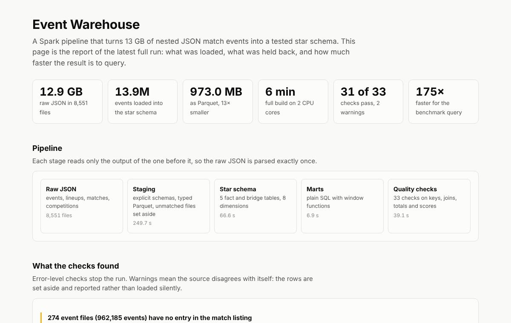

# Event Warehouse

A PySpark pipeline that turns 13 GB of nested JSON match events into a tested, partitioned star schema, then measures what that buys: the same question answered **175× faster** from files **13× smaller**.

**Run report (live):** https://satwik-kotta.github.io/event-warehouse-spark/



## Result of the latest full run

| | |
|---|---|
| Raw input | 12.9 GB of JSON in 8,551 files (14.9M events) |
| Loaded | 13,911,986 events across 3,961 matches and 80 competition-seasons |
| Held back | 274 event files (962,185 events) with no entry in the match listing |
| Warehouse | 973 MB of Parquet in 13 tables plus 2 marts |
| Build time | 6 minutes on 2 CPU cores with a 3.5 GB Spark heap |
| Checks | 33: 31 pass, 2 warnings, 0 errors |
| Benchmark | 67.6 s on raw JSON, 0.39 s on the warehouse, identical answers |

The numbers are in [`reports/run_report.json`](reports/run_report.json) and [`reports/bench.json`](reports/bench.json), written by the run itself.

## Why this data

The source is [StatsBomb Open Data](https://github.com/statsbomb/open-data): every on-ball action in 4,235 football matches, one JSON file per match. It behaves like an application event log:

- **Deeply nested.** A pass carries a recipient, an end location and up to a dozen optional attributes. A shot carries an array with the position of every player in view.
- **Sparse.** Each event type fills in a different sub-object, and flags are only present when true.
- **Spread over several sources.** Events, lineups, match listings and competitions arrive as separate files that have to agree with each other, and do not always.

## Pipeline

```
raw JSON ──► staging ──► star schema ──► marts ──► quality checks ──► run_report.json
 13 GB       typed        4 facts,        SQL       33 checks          rows, sizes,
             Parquet      1 bridge,                                    timings, results
                          8 dimensions
```

**Staging** (`warehouse/staging.py`) is the only step that reads JSON. Schemas are declared in `warehouse/schemas.py` instead of inferred: inference would read all 13 GB twice and return a different schema whenever a rare field is missing from a batch. Staged events are written as Parquet partitioned by competition and season, and everything downstream reads that.

**Star schema** (`warehouse/model.py`):

| Table | Grain | Rows |
|---|---|---|
| `fact_event` | one row per event | 13,911,986 |
| `fact_pass` | one row per pass | 3,836,550 |
| `fact_shot` | one row per shot | 101,227 |
| `bridge_shot_player` | one row per player in view at a shot | 1,305,746 |
| `fact_lineup` | one row per player per match | 152,133 |
| `dim_match`, `dim_team`, `dim_player`, `dim_date`, `dim_competition_season`, `dim_event_type`, `dim_position`, `dim_play_pattern` | one row per id | 9 to 11,889 |

- `fact_pass` and `fact_shot` hold the attributes that only exist for those event types, so `fact_event` stays narrow. Three event types make up 75% of all rows.
- `bridge_shot_player` is the nested freeze-frame array flattened with `posexplode`, which makes "how many defenders were between the shooter and the goal" a join instead of a JSON parse.
- Player and team dimensions are type 1: names and nicknames change over the years, and the most recent wins.
- Facts are partitioned by `competition_id` and `season_id`, because that is how they are filtered.

**Marts** (`sql/`) are plain SQL files run with Spark SQL: `mart_team_match` (one row per team per match, with a rolling five-match expected-goals average from a window function) and `mart_player_season` (ranked within each season).

## dbt layer

The Spark build stops at Parquet. On top of it, [`dbt/`](dbt/) is a dbt project that reads those Parquet tables in place with DuckDB (no load step) and rebuilds the reporting layer the way an analytics team would maintain it: staging views, an intermediate model, and three marts, all documented and tested.

**[dbt docs: lineage graph, models and tests](https://satwik-kotta.github.io/event-warehouse-spark/dbt/)**

```
sources (Parquet star schema) ──► staging (5 views) ──► int_match_sides ──► fct_team_match ──► rpt_team_season
                                                                        └─► fct_player_season
```

| Model | Grain | Notes |
|---|---|---|
| `stg_matches`, `stg_shots`, `stg_passes`, `stg_events`, `stg_lineups` | one row per source row | names attached; shoot-out kicks removed once, in `stg_shots` |
| `int_match_sides` | team per match | each match seen from both sides |
| `fct_team_match` | team per match | port of `sql/mart_team_match.sql`, with a rolling five match xG |
| `fct_player_season` | player per competition-season | port of `sql/mart_player_season.sql`, ranked on xG |
| `rpt_team_season` | team per competition-season | new report table: record, goals, xG for and against |

**50 dbt tests** run with `dbt build`:

- `unique`, `not_null`, `relationships` and `accepted_values` on keys and columns, plus two custom generic tests in `dbt/macros/`: `unique_combination` for the grain of every table and `expression_is_true` for value rules (xG between 0 and 1, wins + draws + losses = matches).
- `assert_goals_reconcile_with_score`: goals from shot events plus own goals equal the published score for every team in every match.
- `assert_dbt_mart_matches_spark_mart`: the dbt model reproduces the Spark SQL mart row for row, with the same goals, shots and xG to 1e-9. This is what makes the port safe to switch to.

On the 2022 World Cup (64 matches, 234,637 events) all 50 pass. Argentina, the winner, leads on xG created (13.94 over 7 matches), while the Netherlands scored 10 goals from 4.99 xG, the biggest overperformance. CI builds the synthetic test warehouse and runs `dbt build` on it on every push.

```bash
make build                     # Spark writes the Parquet warehouse
make dbt                       # dbt build, then dbt docs written to docs/dbt/
```

`EWH_OUT` points dbt at the warehouse folder, the same variable the Spark build uses.

## Data quality

Checks have two levels (`warehouse/quality.py`). An **error** means the warehouse itself is wrong and stops the run. A **warning** means the source disagrees with itself: the rows are set aside, counted and reported.

| Group | Checks |
|---|---|
| Nothing lost on the way in | every file parses; every listed match has events; event numbering within a match has no gaps |
| Keys | primary key unique on every fact and dimension |
| Joins | all 12 foreign keys resolve |
| Totals | pass and shot tables equal the pass and shot events; the bridge equals the sum of the nested arrays |
| Values | expected goals between 0 and 1; coordinates on the pitch |
| Cross-source | goals counted from events equal the score in the match file |
| Schema drift | a sample of raw files is scanned for fields the declared schema does not know |

What they found on the real data:

- **274 event files have no entry in the match listing.** All but two are German Bundesliga matches whose season listing is incomplete. They cannot be assigned a competition or season, so they stay in staging and are left out of the facts. Loading them anyway would have put 962,185 events into a null partition.
- **Goals from events equal the published score in all 7,922 team-matches.** The two numbers come from different files, so this is an end-to-end check on the whole event path. It only holds once own goals are added and shoot-out penalties removed.
- **66 events sit just outside the pitch boundary.** Kept and flagged.

## Benchmark

`python -m warehouse.bench` asks one question two ways on the same machine: shots and expected goals per team for La Liga 2015/2016.

| Path | What Spark reads | Time |
|---|---|---|
| Raw JSON | every event file, with a narrow schema, because files are named by match and not by season | 67.6 s |
| Warehouse | one partition of `fact_shot` | 0.39 s |

Both return the same 20 rows; the script asserts it.

## Run it

```bash
pip install -r requirements.txt     # needs Java 17 or 21
make data        # downloads the raw JSON at the pinned commit, about 13 GB
make build       # staging → star schema → marts → checks
make bench
make dashboard   # writes docs/data.js for the run report page
make test        # no download needed
```

`EWH_RAW`, `EWH_OUT` and `EWH_MEMORY` override the data locations and Spark driver memory.

## Tests

`make test` builds a small synthetic source with the same shape as the real one (three matches, an own goal, a shoot-out) and runs the whole pipeline on it. The tests then break the data eleven ways and confirm each check catches its fault: a dropped event, a duplicated key, a missing dimension row, a truncated file, a new field, a wrong score, an event file with no match. They run in GitHub Actions on every push.

## Limits

- **Batch, full refresh.** Each run rebuilds everything. An incremental load keyed on the source's `last_updated` field is the obvious next step.
- **Local Spark.** Built and measured on one machine with 2 cores. The code uses nothing local-only, but it has not been run on a cluster.
- **Benchmark is one query.** It shows what partition pruning and columnar storage do for a season-level question. A query that needs every event would gain less.
- **Tactics and 360 tracking frames are not modelled.**

## Layout

```
warehouse/   config, schemas, staging, model, marts, quality, run, bench
sql/         mart_team_match.sql, mart_player_season.sql
dashboard/   build.py (run report data)
docs/        run report page, and dbt docs in docs/dbt/
dbt/         dbt project: staging, intermediate and mart models with tests
reports/     run_report.json and bench.json from the latest full run
tests/       synthetic source and pipeline tests
scripts/     download.sh, build_sample.py (synthetic warehouse for dbt in CI)
```

## Data source

Data provided by [StatsBomb](https://github.com/statsbomb/open-data) under their open-data terms. The raw files are not redistributed here; `make data` fetches them at commit `4b73468`.


